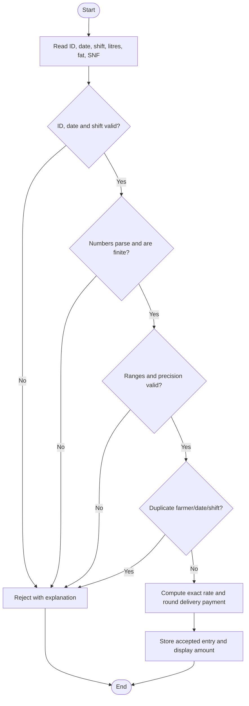
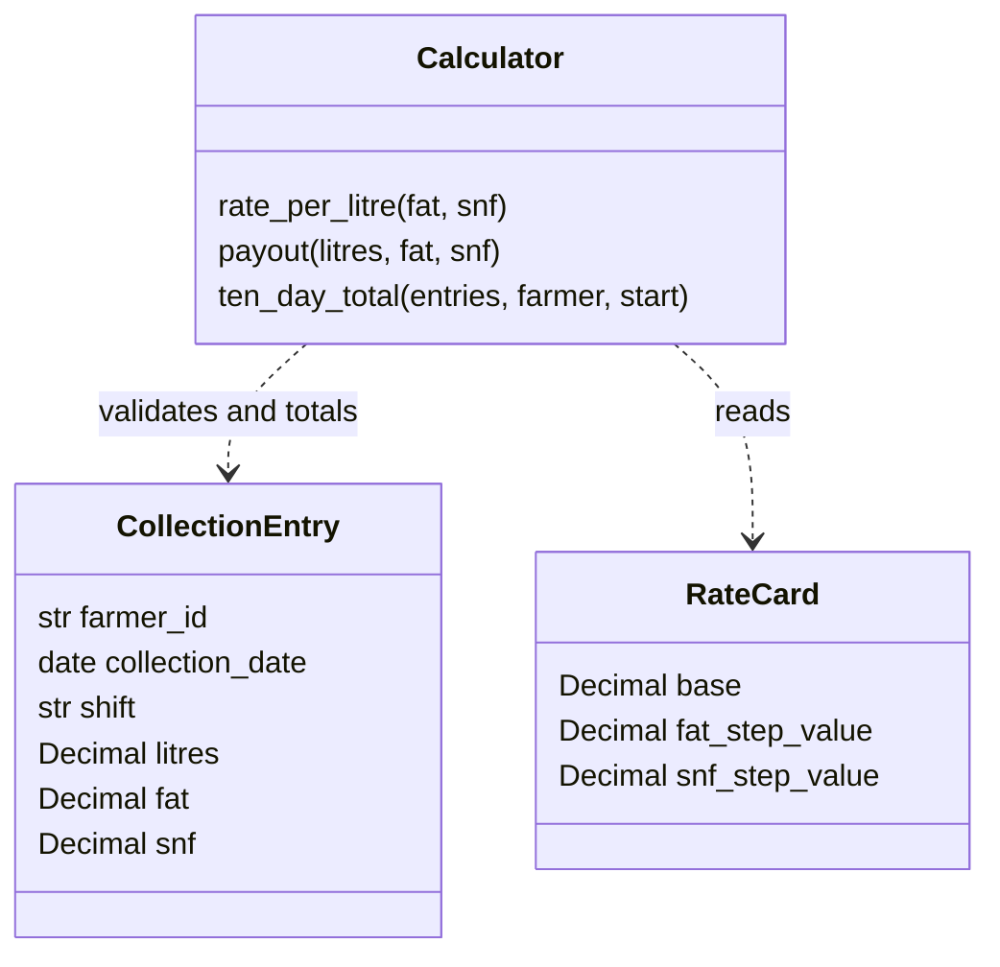

# CSA08 Python Programming - Assignment 1: complete worked solution

## Scope and assumptions

This solution covers Tasks 1-12 of the supplied milk co-operative assignment, including both Complete the Code exercises, alternatives, complexity analyses, validation and the design challenge. The accompanying programs have been executed. Captured stdout and labelled images rendered from it are included in each task folder. These are output images, not terminal screenshots. Faculty-required terminal screenshots must be captured by the student when running the programs.

Student: PROBIR SAHA SHOHOM. Registration number: 1911260319. Program: B.Tech - Computer Science and Engineering; code 1911. Course: CSA08 - Python programing. Repository: https://github.com/Probir127/CSA08-1911260319-Assignment1. This package is prepared with Codex assistance. Task commits record one preparation session, not a week of progressive work. The student must review the solution and submit the repository link to the faculty. No personal submission history is invented.

The following decisions fill gaps in the question; the co-operative must confirm these policies before operational use:

- Original fat and SNF readings have 0.1 percentage-point resolution. Task 12 increases this to 0.01. Litres are accepted to 0.001 L; zero is permitted. There is no invented maximum quantity.
- Fat must be 2.0-7.0 inclusive. The question supplies no SNF limits, so 6.0-10.0 inclusive is an explicit assumed range.
- A collection record includes farmer ID, collection date and AM/PM shift. Farmer IDs are nonempty text to preserve identifiers such as `0012`. At most one record per farmer/date/shift is accepted by the interactive application; corrections should replace a record through a separate audited process.
- A ten-day period is `[start, start + 10 days)`, including the start date and the following nine dates. Payments are rounded per delivery to paise using `ROUND_HALF_UP`; the ten-day bank total is the sum of these posted payments.
- For Task 12, fractional steps are priced proportionally. Rates keep all intermediate decimal places; only the delivery amount is rounded. April-June rates depend on the collection date, including when a ten-day period crosses a season boundary.
- The Task 12 bonus applies to **all litres in the period**, only when that farmer's period quantity is **strictly greater than 500 L**. It is calculated and rounded once per period. The wording could be interpreted differently; this assumption is explicit.

## Task 1 - Understand the problem and identify the data

| Value | Type | Why it is needed |
|---|---|---|
| Farmer ID | `str` | Groups deliveries without losing leading zeroes |
| Collection date | `datetime.date` | Selects the ten-day period and later the season |
| Shift | `str`, AM or PM | Distinguishes two daily deliveries |
| Litres | `Decimal` | Fractional quantity without binary conversion error |
| Fat %, SNF % | `Decimal` | Exact quality readings and adjustments |
| Fat/SNF step counts | integral Decimal originally; fractional Decimal later | Deviations measured in 0.1 percentage points |
| Rate per litre | `Decimal` | Base price plus quality adjustments |
| Posted delivery amount | `Decimal`, two decimal places | The amount credited for a delivery |
| Period total quantity | `Decimal` | Reporting and bonus eligibility |
| Ten-day total | `Decimal`, two decimal places | The bank settlement amount |
| Number of records | `int` | Whole-number count |

Constants are the base rate `30.00`, base fat `3.5`, base SNF `8.5`, step `0.1`, fat-step value `0.40`, SNF-step value `0.30`, permitted ranges and paisa quantum `0.01`. They remain unchanged within one original rate-card run. Naming them prevents inconsistent rate revisions.

Invariants: quantities are nonnegative; all numbers are finite; fat and SNF obey their limits and precision; identity/date/shift are valid; each accepted record produces exactly one posted payment; a statement includes only the requested farmer and period. Negative quality deviations are valid and must lower the rate. Negative quantities are invalid. An input error must not silently become a zero payment.

Alternative: `litres1, fat1, snf1, litres2, fat2, snf2, ...` requires at least 900 quantity/quality variable names for 300 entries, plus the other fields. The formulas would be copied 300 times. A list of fixed-length records supports a loop:

```python
entries = [('10', '3.5', '8.5'), ('8.5', '4.2', '8.7')]
for litres, fat, snf in entries:
    amount = payout(litres, fat, snf)
```

Both designs process n entries in O(n) time and occupy O(n) data space. Separate variables do not have worse asymptotic complexity; their source-code length, error rate and maintenance effort grow with n. A loop has fixed source-code size and accepts any number of records. Streaming the data instead of keeping the list reduces auxiliary storage to O(1) for one farmer's total.

## Task 2 - Values and types in the interpreter

The file `Task02/output.txt` contains a reproduced prompt/result transcript of executed expressions. It is generated by evaluating the expressions, rather than a manually captured REPL screenshot.

```text
>>> type(10)
<class 'int'>
>>> type(10.0)
<class 'float'>
>>> type("10")
<class 'str'>
>>> type(True)
<class 'bool'>
>>> type([10, 8.5])
<class 'list'>
>>> 7 / 2
3.5
>>> 7 // 2
3
>>> 7 % 2
1
>>> -7 // 2
-4
>>> 0.1 + 0.2
0.30000000000000004
>>> 0.1 + 0.2 == 0.3
False
>>> Decimal("0.1") + Decimal("0.2") == Decimal("0.3")
True
```

`/` performs true division. `//` floors toward negative infinity, so -3.5 becomes -4. `%` returns the remainder consistent with `a == (a // b) * b + a % b`. `bool` is a separate type although it is also a subclass of `int`; measurement validation deliberately rejects booleans. A list can hold values of different types.

Most decimal fractions have no finite binary representation. Binary rounding explains the float comparison; formatting to two places changes the display, not the stored value.

Complete TODO 1 using:

```python
total = Decimal('0.00')
for amount in items:
    total += Decimal(amount)
return total
```

The fully completed original exercise is `Task02/complete_code.py`. Actual results:

```text
float  : 33400.30000000061
Decimal: 33400.30
False True
Decimal from float: 33400.29999999999857893118278
```

`Decimal(float(amount))` imports the already approximated binary number; Decimal cannot recover the original text. Decimal arithmetic also obeys a finite context precision, normally 28 significant digits. That is ample for this dataset, but Decimal is not unlimited-precision arithmetic by default.

Alternatives:

```python
# Exact paise for input strings already representing whole-paisa payments
total_paise = 0
for text in payments:
    value = Decimal(text) * 100
    if value != value.to_integral_value():
        raise ValueError('Payment is not a whole number of paise')
    total_paise += int(value)

# A float alternative, weaker as a general monetary policy
total_float = 0.0
for text in payments:
    total_float = round(total_float + float(text), 2)
```

The paise method gives 3,340,030 paise, exactly Rs 33,400.30. Decimal gives the same exact decimal total. Float with rounding after every addition also displays 33,400.30 for this example, but binary storage and ties-to-even rounding do not guarantee the stipulated financial policy for every input. `round(2.675, 2)` is a familiar example yielding `2.67`.

Measured shallow sizes in this interpreter: int 28 bytes, float 24 bytes, Decimal 120 bytes. These depend on Python implementation, version and magnitude; `sys.getsizeof()` excludes referenced objects. With bounded monetary magnitudes, each addition is O(1), total time O(n), and a running accumulator O(1) space. For arbitrarily large values, integer/Decimal digit counts must be included in arithmetic costs. A list of n payment objects occupies O(n) space regardless of the accumulator type.

## Task 3 - Variables and constants

The authoritative original constants are in `Task06/calculator.py`, using `Decimal` strings. `Task07/milkrate.py` intentionally preserves the supplied float-based teaching exercise.

Names may contain letters, digits and underscores, cannot start with a digit, are case-sensitive and cannot be keywords. Use descriptive `snake_case` variables and functions, and `UPPER_CASE` constants. Python does not make an uppercase name immutable: `BASE_RATE = ...` can rebind it. The convention communicates intent; functions read rates and do not change them.

```python
value = 10       # type(value) is int
value = '10'     # type(value) is str; the name has been rebound
a, b = 1, 2
a, b = b, a     # right-hand values are evaluated before assignment
```

Dynamic typing means objects have types and names can refer to objects of different types. Multiple assignment is useful for related values and swapping without an explicit temporary variable.

Alternatives: magic numbers embed `30.00`, `0.40` and `0.30` at every calculation site. A dictionary can centralize them:

```python
RATE_CARD = {'base': Decimal('30.00'),
             'fat': Decimal('0.40'), 'snf': Decimal('0.30')}
```

If k sites duplicate the rate card, a revision requires inspecting/changing O(k) sites. One centralized card requires O(1) locations for these fixed three values. Both run in O(1) per record. Dictionary lookup is expected O(1) and adds a small fixed memory overhead. Repeated source literals do not necessarily create k independent runtime numeric objects because Python may reuse constants; the reliable problem is duplicated policy, not a claimed memory multiplier.

## Task 4 - Correct expressions

For original one-decimal readings:

```python
fat_steps = (fat - BASE_FAT) / STEP
snf_steps = (snf - BASE_SNF) / STEP
rate = BASE_RATE + fat_steps * FAT_STEP_VALUE + snf_steps * SNF_STEP_VALUE
amount = money(litres * rate)
```

The exact implementation validates one-decimal resolution, making these step counts integral. In the float teaching exercise use `round((fat - 3.5) / 0.1)` to recover an intended whole step before calculating the rate. This use of `round` assumes readings intended to lie on the 0.1 grid; it is not a universal rule for two-decimal readings.

Parentheses force subtraction before division; multiplication/division precede addition/subtraction. Most equal-precedence arithmetic operators associate left to right. Exponentiation associates right to left: `2 ** 3 ** 2 == 2 ** 9 == 512`. It binds more tightly than a leading unary minus: `-2 ** 2 == -4`, but `(-2) ** 2 == 4`. `2 ** -2 == 0.25` illustrates that the right-hand exponent may be negative.

Three observed surprises are `-2 ** 2 == -4`, `2 ** 3 ** 2 == 512`, and `(3.1 - 3.5) / 0.1 == -3.999999999999999`. On the execution interpreter `(4.2 - 3.5) / 0.1` produced `7.000000000000002`; the PDF's `7.000000000000001` is illustrative rather than an exact expected last digit. Both are binary approximation artifacts.

`round(-3.6) == -4`, `int(-3.6) == -3` (toward zero), and `math.floor(-3.6) == -4` (toward negative infinity). Python's built-in `round` resolves exact ties toward an even result; the payment implementation explicitly selects Decimal half-up instead.

Holding SNF at 8.5:

| Fat | Raw float steps | `round` steps/rate | `int` steps/rate | `floor` steps/rate |
|---|---|---|---|---|
| 4.2 | 7.000000000000002 | 7 / 32.80 | 7 / 32.80 | 7 / 32.80 |
| 3.1 | -3.999999999999999 | -4 / 28.40 | -3 / 28.80 | -4 / 28.40 |

Here `int` incorrectly pays 40 paise extra per litre at fat 3.1. `floor` happens to work in these two examples, but can fail for other slightly underestimated positive integers. Each method takes O(1) time and space for fixed-size inputs.

`MIN_FAT <= fat <= MAX_FAT` is a chained comparison equivalent to both comparisons joined by `and`, with `fat` evaluated once. Use `and` to require all validations, `or` to allow alternatives, and `not` to reject a condition. Boolean operations short-circuit; parentheses make mixed conditions clear.

## Task 5 - Read input and convert types

`input()` returns a string because terminal input is text. Use `int(text)` for an integer count, `float(text)` for a binary floating-point exercise, and `Decimal(text)` for actual measurements/money. `int('8.5')` fails; `int(float('8.5'))` silently discards the fractional part and is unsuitable for validation.

`float('8,5')` and `float('eight')` raise `ValueError`. Leading/trailing whitespace is accepted. This solution asks for a decimal point instead of guessing whether a comma means a decimal separator or a thousands separator.

`Task05/demo.py` supplies a simple ASCII string grammar: strip whitespace, remove at most one sign, permit one dot, require a digit and reject all other characters. `str.isdigit()` alone cannot validate signed decimal quantities. Its Unicode digit acceptance can also be wider than the intended input grammar.

Alternative:

```python
try:
    value = float(text)
except ValueError:
    print('Invalid number')
else:
    if not math.isfinite(value):
        print('Number must be finite')
```

| Text | Simple grammar | `float` with finite check |
|---|---|---|
| `8,5` | Reject | Reject |
| ` 8.5 ` | Accept after stripping | Accept |
| `eight` | Reject | Reject |
| `nan` | Reject | Conversion succeeds, finite check rejects |
| `1e2` | Reject by this chosen grammar | Accept as 100.0 |

Both approaches scan m input characters, so O(m) time per field; with bounded input lengths, O(1) per entry. A pre-check plus conversion scans twice but remains O(m). Stripping/removing characters can allocate O(m) temporary space. Exception-based conversion is shorter and delegates numeric syntax to Python; business rules still need explicit validation.

For aligned output, `f'{farmer_id:<10}{amount:10.2f}'` left-aligns an ID in ten columns and right-aligns an amount with two decimal places. `Task09/cli.py` reads full entries, rejects errors, rejects duplicate shifts and prints the selected ten-day total. Its recorded two-entry example produces Rs 583.90.

## Task 6 - Organize the logic into functions

| Function | Parameters | Return |
|---|---|---|
| `number` | text or a numeric value | finite Decimal |
| `measurement` | value, bounds, resolution | validated Decimal |
| `money` | exact Decimal amount | two-decimal half-up amount |
| `rate_per_litre` | fat, SNF | rate as Decimal |
| `payout` | litres, fat, SNF | posted payment as Decimal |
| `validate_entry` | record dictionary | payment, or raises ValueError |
| `ten_day_total` | records, farmer ID, period start | sum of that farmer's in-period payments |

Each function in the core module has a docstring. `return` transfers a reusable result to the caller; `print` writes text and normally returns `None`. Keeping calculation separate from printing allows tests, statements and imports to use the same logic.

Parameters, intermediate variables and totals are local. Module constants are global to the module and can be read without a `global` declaration. Assigning to a name inside a function normally makes it local. Do not use `global` to revise a rate during a calculation: select a new immutable card at a controlled boundary instead.

Alternative: a single long script can read, validate, compute and print in one loop; its O(n) complexity is unchanged, but repeated workflows duplicate code and are harder to test. A short lambda such as `lambda litres, rate: litres * rate` is valid for a simple expression but unsuitable for multi-step validation and rounding policy. Functions add O(1) call overhead per record, so n calls add O(n) work without changing the overall O(n) class. This is usually a small cost for clarity; the included timing experiment measures real Decimal work rather than claiming call overhead is zero.

## Task 7 - Build a module

The fully completed file is `Task07/milkrate.py`; only the two TODO bodies have been implemented in the supplied executable program. Its core is:

```python
fat_steps = round((fat - 3.5) / 0.1)
snf_steps = round((snf - 8.5) / 0.1)
return round(BASE_RATE + fat_steps * FAT_STEP_VALUE
             + snf_steps * SNF_STEP_VALUE, 2)

# payout():
return round(litres * rate_per_litre(fat, snf), 2)
```

Actual direct-run results:

```text
   10 L  fat 3.5  snf 8.5  rate  30.00  pay   300.00
  8.5 L  fat 4.2  snf 8.7  rate  33.40  pay   283.90
   12 L  fat 3.1  snf 8.3  rate  27.80  pay   333.60
```

`import milkrate` binds the module; call `milkrate.payout(...)`. `from milkrate import payout` binds that function directly. `import milkrate as mr` binds an alias; call `mr.payout(...)`.

The correct guard is `if __name__ == '__main__':` including the double underscores. When run directly, `__name__` is `'__main__'`; when imported normally it is `'milkrate'`. The second script prints only its explicitly requested payment of 300.0, not the three-row demonstration. Without the guard, the table would run as an unwanted import side effect.

`decimal` provides decimal arithmetic and rounding; `math` provides operations such as floor. Python normally searches the script directory (or current directory in interactive/`-c` modes), configured paths and installed library directories through `sys.path`, subject to execution options. A local file named `decimal.py` can accidentally shadow the standard module.

Copying functions into s scripts means inspecting/updating s copies after a revision: O(s) maintenance rather than a single module change. Initial import must locate, load and execute the module, with cost dependent on module size and top-level work. Normal subsequent imports in the same process use `sys.modules`; they do not rerun the module. Separate processes each import independently. A cached import does not change the O(n) payment loop.

The float-based required exercise demonstrates syntax and imports; the exact Decimal module in Task06 is the recommended settlement calculator.

## Task 8 - Plan the algorithm before coding

Understand: identify inputs, settlement rules and invalid conditions. Plan: choose Decimal values, validation, functions and the ten-day filter. Write: implement the planned functions and input loop. Test: compare independent expected results with execution and refine the design where requirements change.

The PDF refers to the SIMATS Engineering pseudocode standard without supplying its detailed syntax. The following uses conventional structured `BEGIN/END`, `INPUT`, `OUTPUT`, `IF/THEN`, `FOR EACH` and assignment notation; exact compliance with an unavailable institutional template is not claimed.

```text
ALGORITHM ONE_PAYMENT(litres, fat, snf)
BEGIN
    IF any value is nonnumeric or nonfinite THEN
        OUTPUT "Reject entry"
        RETURN ERROR
    END IF
    IF litres < 0 OR fat < 2.0 OR fat > 7.0
       OR snf < 6.0 OR snf > 10.0
       OR measurement resolution is invalid THEN
        OUTPUT "Reject entry"
        RETURN ERROR
    END IF
    fat_steps <- (fat - 3.5) / 0.1
    snf_steps <- (snf - 8.5) / 0.1
    rate <- 30.00 + fat_steps * 0.40 + snf_steps * 0.30
    amount <- ROUND_HALF_UP(litres * rate, 2)
    RETURN amount
END

ALGORITHM TEN_DAY_TOTAL(entries, selected_farmer, start)
BEGIN
    total <- 0.00
    finish <- start + 10 days
    FOR EACH entry IN entries DO
        VALIDATE farmer ID, date and shift
        amount <- ONE_PAYMENT(entry.litres, entry.fat, entry.snf)
        IF validation fails THEN RETURN ERROR END IF
        IF entry.farmer = selected_farmer
           AND start <= entry.date AND entry.date < finish THEN
            total <- total + amount
        END IF
    END FOR
    RETURN total
END
```

Validation flowchart:



Data/module relationship diagram (UML-style):



The diagram models responsibilities; the beginner implementation uses dictionaries and module functions rather than defining these as Python classes.

Hand trace for three deliveries by the same farmer within the period:

| Litres | Fat | SNF | Fat steps | SNF steps | Rate | Payment | Running total |
|---|---|---|---|---|---|---|---|
| 10 | 3.5 | 8.5 | 0 | 0 | 30.00 | 300.00 | 300.00 |
| 8.5 | 4.2 | 8.7 | 7 | 2 | 33.40 | 283.90 | 583.90 |
| 12 | 3.1 | 8.3 | -4 | -2 | 27.80 | 333.60 | 917.50 |

Alternative algorithms: append payments to a list, then sum it; or add each payment immediately to a running total. Both take O(n) time. The list occupies O(n) extra space; the accumulator occupies O(1), excluding retained source records. Record storage remains necessary for audit, correction, statements and disputes. A set used to detect duplicates adds O(n) storage; the real interactive application therefore uses O(n) memory even though the isolated summation algorithm can use O(1).

## Task 9 - Implement and test

Run `python3 Task09/tests.py`. All expected results below are independently calculated and asserted against actual execution.

| Case | Litres, fat, SNF | Expected | Actual |
|---|---|---|---|
| Standard | 10, 3.5, 8.5 | 300.00 | 300.00 PASS |
| Both above | 8.5, 4.2, 8.7 | 283.90 | 283.90 PASS |
| Both below | 12, 3.1, 8.3 | 333.60 | 333.60 PASS |
| Lowest fat | 5, 2.0, 8.5 | 120.00 | 120.00 PASS |
| Highest fat | 4, 7.0, 8.5 | 176.00 | 176.00 PASS |
| Zero quantity | 0, 3.5, 8.5 | 0.00 | 0.00 PASS |
| Exact half-paisa tie | 0.001, 2.1, 8.7 | 0.03 | 0.03 PASS |
| Text quantity | eight, 3.5, 8.5 | Reject | Reject PASS |
| Negative quantity | -1, 3.5, 8.5 | Reject | Reject PASS |
| Fat below/above limit | 1, 1.9/7.1, 8.5 | Reject both | Reject both PASS |
| Decimal comma | 1, 3.5, "8,5" | Reject | Reject PASS |
| NaN/infinity | nonfinite litres | Reject | Reject PASS |
| Original precision violation | 1, 3.55, 8.5 | Reject | Reject PASS |
| SNF above assumed limit | 1, 3.5, 10.1 | Reject | Reject PASS |

For the five-entry hand calculation use the first five normal/boundary rows: `300.00 + 283.90 + 333.60 + 120.00 + 176.00 = 1213.50`. The asserted actual total is also 1213.50. The half-paisa case has rate `30 - 14*0.40 + 2*0.30 = 25.00`; `0.001*25 = 0.025` rounds upward to 0.03.

Further tests include the last included date, the first excluded date, exclusion of another farmer and an invalid shift. The date/farmer example returns 600.00, excluding the next period's 300.00 and another farmer's 300.00. Sample interactive input is stored in `Task09/input.txt`; its actual output is `Task09/cli_output.txt`.

Manual testing requires retyping every case and visually comparing each result after every revision. Assert-based testing stores inputs and expected outputs and reruns automatically. For q tests both require O(q) test executions, but manual work is O(q) human actions per run versus one invocation for an automated suite. Across r revisions both execute O(rq) cases; automation reduces human effort and comparison errors. Run assert tests without Python's `-O` option, which disables assertions.

## Task 10 - Expectations versus execution

The experiment adds a known posted payment of Rs 33.40 n times with explicit loops. This isolates accumulation and avoids differences between Python versions' implementations of float `sum`. It is a controlled repeated-payment dataset, not a claim that all real farmers receive the same amount. Dataset preparation and input/output are excluded from accumulation timings. Float, Decimal and integer loops were each timed once using `time.perf_counter()`; these observations are not statistically stable performance guarantees.

| Payments | Exact total (Rs) | Float representation | Float minus exact (Rs) | Float / Decimal / paise time (ms) |
|---|---|---|---|---|
| 300 | 10020.00 | 10019.999999999944 | -5.638867e-11 | 0.0032 / 0.0108 / 0.0026 |
| 6,000 | 200400.00 | 200399.99999997852 | -2.147863e-08 | 0.0520 / 0.1759 / 0.0582 |
| 150,000 | 5010000.00 | 5010000.000000843 | 8.428469e-07 | 1.3907 / 4.4407 / 1.4846 |

Measured interpreter: `3.15.2 (v3.15.2:5e58eaad7c5, Oct 25 2026, 14:19:34) [Clang 21.0.0 (clang-2100.1.1.101)]`.

Full exact calculator timings (validation, rate calculation, per-delivery rounding and accumulation):

| Deliveries | Time (ms) |
|---|---|
| 300 | 0.3718 |
| 6,000 | 7.4274 |
| 150,000 | 183.1995 |

Each full calculation uses 1 L at 4.2% fat and 8.7% SNF, producing 33.40. File input/output is excluded.

Raw float and exact Decimal totals disagree at every size, but rounding the float totals to two decimal places gives the same bank amount in all three measured cases. Thus this dataset demonstrates representation drift without demonstrating a one-paisa settlement error at these sizes. It would be incorrect to claim a bank mismatch solely from these raw errors.

Decimal and integer paise give the expected totals exactly within the tested magnitudes. Decimal addition here is slower than float addition but still small relative to terminal input or storage work. These are accumulation timings, not complete calculator throughput.

Rounding policy can produce a real monetary difference even with Decimal. Two deliveries of 0.001 L at Rs 25.00 have unrounded payments 0.025 each. With the chosen policy, each posts 0.03 and the bank total is 0.06. Rounding only their unrounded aggregate gives 0.05, which disagrees with the posted ledger. If a co-operative instead defines aggregate-only settlement, that is a different policy and must be implemented consistently.

Rate-cache alternative:

```python
cache = {}
for fat, snf in readings:
    key = (fat, snf)  # also include rate-card version/season when applicable
    if key not in cache:
        cache[key] = rate_per_litre(fat, snf)
    rate = cache[key]
```

For 150,000 records repeating 3 pairs, recalculation took 0.124401 s and a cache built during the run took 0.006787 s. Results were asserted equal. Cache timing includes its initial three rate calculations. These timings cover rate calculation and summation, not record input or payout rounding.

Both recalculation and dictionary lookup are O(1) per entry for bounded values; caching reduces the constant factor rather than changing the complexity class. Total time remains O(n), with O(k) extra space for k quality pairs. A three-pair repeating dataset strongly favors caching; real gains depend on repetition. A cache must include the rate-card version/season, or be discarded on revision. Otherwise cached rates can become wrong even though lookup is fast.

## Task 11 - Final recommendation

Use Decimal values constructed from text, validate before calculating, apply one named rate card, round each delivery half-up to paise and sum posted amounts. Integer paise are an excellent representation for the posted ledger, but arbitrary quantity times rate may contain fractions of a paisa, so the conversion must follow the rounding rule rather than truncate.

Keep calculation functions in a single module and input/printing separately. The tests show correct standard, boundary, invalid and half-paisa behavior; the scale experiment shows exact Decimal/paise totals at 150,000 payments. The result supports correctness for tested magnitudes, not an unlimited guarantee for all possible quantities or environments.

Revise a card centrally, validate it, assign an effective date/version and preserve the original card associated with past deliveries. The small original module can use constants; seasonal operation needs a selected card per collection date. A dictionary cache is optional after profiling and must respect card versioning.

Limitations: this teaching program has no persistent database, authentication, concurrent clerks, audit log, cancellation workflow or durable duplicate detection. SNF limits, quantity resolution, bonus interpretation and fractional-step policy require confirmation. Decimal has a finite context and extreme input magnitudes require bounds/precision policy. Stored quantities and effective dates must remain available for reconciliation. Full district deployment would add durable records and transactions while preserving the tested arithmetic functions.

The district has 150,000 farmers, not necessarily 150,000 records. At two shifts daily over ten days it can create up to 3,000,000 records. One pass over n records is O(n); aggregating all farmers in one dictionary requires O(F) totals for F farmers. Re-scanning all n records once per farmer would be O(Fn) and should be avoided. The single-farmer `ten_day_total` is suitable for one statement or prefiltered records. Database grouping or one-pass aggregation is appropriate for all statements.

Alternative: `Task11/demo.py` reads a small JSON file whose decimal values are strings, validates the keys and nonnegative finite values, then creates Decimal rates. With t settings and B input bytes, parsing needs O(B) time and O(B) storage overall; if setting sizes are bounded, this is O(t). Module constants avoid separate configuration-file I/O but still have initialization cost. Configuration allows authorized rate revisions without redistributing calculation source, at the cost of validation, versioning and file-management responsibilities. Historical cards must not simply be overwritten.

## Task 12 - Re-evaluate and adapt the design

### A. Impact analysis

The analyser adds two-decimal quality readings. The base becomes 32.00 and the fat step 0.45 for April-June; SNF remains 0.30 per step. A strict quantity threshold introduces a period-level bonus. Constants, precision validation, rate selection, step expressions, the payout function and the final statement are affected. A period may cross a season boundary, so a single season argument for an entire statement is insufficient unless that case is handled.

With fat 4.25 and SNF 8.65, proportional step counts are 7.5 and 1.5, not rounded integers. The revised April rate is `32 + 7.5*0.45 + 1.5*0.30 = 35.825`. For 10 L, the amount is 358.25. Rounding the rate prematurely to 35.83 would give 358.30, five paise too much.

### B. Evaluate the original design

Retain Decimal parsing, validation structure, function boundaries, per-delivery rounding and module separation. Modify quality resolution and rate/statement logic. The original exact module deliberately rejects 4.25 at its one-decimal validation gate, so it cannot be retained unchanged.

The old whole-step expression would also discard analyser detail. For the example, nearest whole steps of 8 and 2 under half-up yield an April rate of 36.20 and a 10 L payment of 362.00 instead of 358.25. At 3.45/8.45 the proportional April rate is 31.625 and payment is 316.25. Different tie rules for nearest whole steps can produce different answers; they are policy choices, not interchangeable arithmetic fixes.

The question does not state whether to interpolate, round to the nearest 0.1 or count completed steps. This solution chooses proportional pricing to preserve analyser precision. If the union requires nearest whole steps, explicitly quantize step counts with an agreed tie rule and update the expected tests. Do not silently use Python `round` as a business rule.

### C. Revised implementation

Decision: **MODIFY** the original design. `Task12/seasonal.py` provides:

- `select_rates(collection_date)` for effective seasonal values;
- `exact_rate(fat, snf, collection_date)` allowing 0.01 precision and fractional steps;
- `seasonal_payout(...)` rounding the exact quantity-rate product once;
- `bonus(total_litres)` applying 0.50 to all litres only above 500;
- `statement(entries, farmer_id, start)` selecting records, rejecting duplicate selected deliveries, adding posted delivery payments and adding one period bonus.

Core expressions:

```python
rate = base + (fat - BASE_FAT) / STEP * fat_value \
            + (snf - BASE_SNF) / STEP * snf_value
payment = money(litres * rate)
extra = money(total_litres * Decimal('0.50')) if total_litres > 500 else Decimal('0.00')
final_total = sum_of_posted_payments + extra
```

The complete runnable source, including helper imports and validations, is supplied in the task folder. At 500 L there is no bonus; at 501 L the bonus is 250.50, rather than 0.50 on only the excess litre.

### D. Evidence-based defence

Run `python3 Task12/tests.py`. All rows below passed:

| Date / case | Expected rate | 10 L payment / bonus | Actual |
|---|---|---|---|
| March 31, standard | 30.00 | 300.00 | PASS |
| April 1, standard | 32.00 | 320.00 | PASS |
| June 30, standard | 32.00 | 320.00 | PASS |
| July 1, standard | 30.00 | 300.00 | PASS |
| April, 4.25 / 8.65 | 35.825 | 358.25 | PASS |
| November, 4.25 / 8.65 | 33.450 | 334.50 | PASS |
| April, 3.45 / 8.45 | 31.625 | 316.25 | PASS |
| Period quantity 499.999 L | - | bonus 0.00 | PASS |
| Period quantity 500 L | - | bonus 0.00 | PASS |
| Period quantity 500.001 L | - | bonus 250.00 after rounding | PASS |
| Period quantity 501 L | - | bonus 250.50 | PASS |

Complete statements for 250 L and 251 L at standard quality:

- April: `501*32 = 16032.00`, plus 250.50 bonus gives **16282.50**.
- November: `501*30 = 15030.00`, plus 250.50 bonus gives **15280.50**.
- Mixed March 31/April 1 period, 10 L on each date: `300.00 + 320.00 = 620.00`, no bonus.

Tests also reject a three-decimal quality reading. These examples show that existing function/module boundaries remain useful and a full redesign is unnecessary. The trade-off is more explicit date and rounding policy, which prevents hidden errors. The new formula remains O(1) per delivery, selecting the card is O(1), and an entire statement remains O(n). Duplicate detection adds O(n) space in this implementation. All-farmer running totals need O(F) aggregation space, plus whichever audit records are retained.

## Source code and execution evidence

Every task has runnable Python and an actual `output.txt`. Task07 preserves the required float exercise; Task06 is the authoritative original Decimal calculator; Task09 is the interactive application and original test suite; Task12 is the modified calculator and its tests. Commands and student submission steps are in README.md. All runtime dependencies are from Python's standard library.
